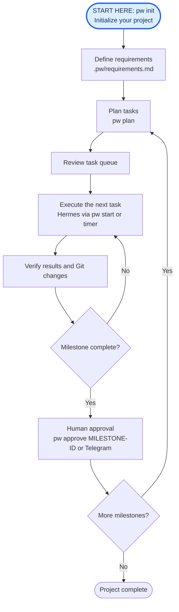

# Projectwright

Projectwright helps build software from requirements by organizing work into **tasks** and **milestones**. A task is one small step of work; a milestone groups related tasks into a result you can review and approve before the project moves forward.

**Hermes performs the work, Projectwright manages the workflow, and humans approve completed milestones.** Projectwright coordinates planning, execution, verification, and Git safety checks. You can run tasks manually or enable a timer for unattended execution—neither mode bypasses milestone approvals.

Your code, Git history, and Projectwright state live in one repository. Projectwright files are stored in `.pw/` and ignored by Git by default. New projects normally live under `~/projects`, but you can choose any location.

## How it works



Each milestone must pass its acceptance checks and receive explicit human approval before strict milestone sequencing continues. The diagram shows the normal path; if a task fails verification, Projectwright reports a blocker for review rather than automatically treating it as complete.

## 1. Install

**Prerequisites:** Ubuntu 24.04 or 26.04, Git, Python 3, a configured [Hermes](https://github.com/NousResearch/hermes-agent) CLI, and a working user-level systemd session if you want scheduled execution. Set your Git user name/email before making commits.

Install the APT prerequisites, download the Projectwright archive signing key, and add the signed APT source. These commands are for Ubuntu 24.04 and 26.04:

```sh
sudo apt update
sudo apt install -y ca-certificates curl gnupg

keyfile=$(mktemp)
curl -fsSL https://leftyfb.github.io/projectwright/projectwright-archive-keyring.gpg -o "$keyfile"
gpg --show-keys --with-fingerprint "$keyfile"
```

**Verify the key before trusting it.** Obtain Projectwright's 40-character APT signing-key fingerprint from a **separately authenticated maintainer announcement** (not the downloaded key, the APT site, or a fingerprint file fetched from that same site). The maintainer must publish and confirm this reference out-of-band before a first-time user proceeds. If you don't have a trustworthy reference, **stop here**—do not install the key or add the repository.

Enter the independently verified fingerprint below. The comparison is case-insensitive and refuses an invalid or mismatched value.

```bash
read -r -p "Verified 40-character Projectwright APT key fingerprint: " expected_fingerprint
expected_fingerprint="${expected_fingerprint^^}"
actual_fingerprint="$(gpg --batch --show-keys --with-colons "$keyfile" |
  awk -F: '$1 == "fpr" {print toupper($10); exit}')"

if [[ ! "$expected_fingerprint" =~ ^[0-9A-F]{40}$ ]] ||
   [[ "$actual_fingerprint" != "$expected_fingerprint" ]]; then
  echo "REFUSED: missing, invalid, or mismatched signing-key fingerprint" >&2
  rm -f "$keyfile"
  exit 1
fi
echo "Signing-key fingerprint matches the independently verified reference."
```

Only after that check succeeds, finish installation:

```sh
sudo install -m 0644 "$keyfile" /usr/share/keyrings/projectwright-archive-keyring.gpg
rm -f "$keyfile"

echo 'deb [signed-by=/usr/share/keyrings/projectwright-archive-keyring.gpg] https://leftyfb.github.io/projectwright/ stable main' \
  | sudo tee /etc/apt/sources.list.d/projectwright.list

sudo apt update
sudo apt install projectwright
pw setup
```

You can upgrade Projectwright later with the normal `sudo apt update && sudo apt upgrade` process.

Run `pw setup` as **your normal user**, not with sudo. It validates Hermes and offers optional Telegram integration if Hermes already has Telegram credentials. Telegram is **not required** to run tasks or approve milestones locally.

## 2. Start your own project

You can create a new repository or add Projectwright to an existing one.

**New, empty project:**

```sh
pw init ~/projects/myproject
cd ~/projects/myproject
```

Projectwright creates the Git repository on `main`, adds `/.pw/` to a new `.gitignore`, and **automatically commits that file**, giving the project a clean initial Git HEAD. Git must have an author identity configured (`user.name` and `user.email`) for this automatic commit. If Git cannot make the commit, `pw init` prints explicit recovery instructions.

**Existing repository** (run at its Git root):

```sh
cd /path/to/myproject
pw init .
```

Both initialize `.pw/` without enabling planning, unattended execution, or a timer. The repository directory name becomes its Projectwright project ID. Use simple lowercase names such as `myproject`.

For an **existing Git repository or non-empty directory**, `pw init` does **not** make Git commits. It preserves the existing `.gitignore` and appends `/.pw/` if necessary. Review `git status --short`, then commit any resulting changes yourself before planning.

### Write and review requirements

```sh
pw requirements --edit
```

This opens `.pw/requirements.md`. Describe what you want to build, ordered requirements, incremental milestones, and what counts as success. Strict milestone approval uses an **Acceptance** block for each milestone. For example:

```md
## APP-1 — Build the application

### APP-1-M1 — Implement a working first version
- The application supports its basic workflow.
- A unit test covers the core behavior.

#### Acceptance
- **Command:** `python3 -m unittest discover -s tests`
- **Scope:** `app.py`
- **Scope:** `tests`
```

The acceptance command is run directly, **not through a shell**. Scope entries are literal relative paths and must be tracked in Git when approval occurs. In a new project, the test and source files above are **proposed future deliverables**, not pre-existing files or proven commands. Adjust the names and verify the command before authorizing work. For a larger project, you can ask an LLM to help draft and review requirements using the [optional drafting prompt](docs/llm-requirements-onboarding.md).

For a new empty project, the initial `.gitignore` commit was already created by `pw init`; no additional commit is needed until you add application files. For an existing project, ensure you have a clean Git HEAD before planning. If `pw init` changed `.gitignore`, review and commit that change:

```sh
git status --short
git add .gitignore
git commit -m "Ignore Projectwright state"
```

Do not run the commit command when `git status` is already clean. Operational `.pw/` files are ignored by default; do not force-add them.

### Plan and inspect

```sh
pw config set planning.milestone_sequence strict
pw plan
pw status
cat .pw/queue.md
```

`pw plan` authorizes **planning only** and asks Hermes to produce a queue. Read the proposed tasks before running them. If status says blocked, resolve its specific reported issue first; it does not mean you should disable safety gates.

### Run one task, review, repeat

```sh
pw start
pw status
git status --short
cat .pw/work_log.md
```

`pw start` asks for confirmation for **one** dispatcher run; it does not turn on unattended scheduling. Repeat after inspecting each result. Git changes may be committed as part of the task queue. When a milestone is complete, follow [Milestone approval](#5-milestone-approval) below.

## 3. Try the complete Task Tracker example

This is a disposable example that **Hermes builds**; the finished task tracker is not shipped as a prebuilt app. No Projectwright source checkout is needed for an APT installation.

```sh
pw init ~/projects/task-tracker
cd ~/projects/task-tracker
cp /usr/share/doc/projectwright/examples/task-tracker/starter/README.md README.md
cp /usr/share/doc/projectwright/examples/task-tracker/requirements.md .pw/requirements.md
git add README.md .gitignore
git commit -m "Initialize task-tracker"
pw config set planning.milestone_sequence strict
pw plan
pw status
cat .pw/queue.md
```

The requirements contain two milestones: `TRACK-1-M1` builds the application and its initial tests; `TRACK-1-M2` expands validation and documentation. Confirm the queue looks appropriate before continuing.

**Manual example (no Telegram needed):**

```sh
pw start
pw status
git status --short
cat .pw/work_log.md
```

Repeat `pw start` and inspect the results until M1 finishes. Hermes should have created `task_tracker.py` and a `tests/` directory. Run the M1 acceptance command to see its result:

```sh
python3 -B -m unittest discover -s tests -p test_task_tracker_m1.py
```

Review the implementation and commits; a passing test alone **does not approve** a milestone. To approve locally:

```sh
pw approve TRACK-1-M1
pw plan
pw status
```

After approval, plan the next milestone and repeat the one-task cycle. When M2 finishes, inspect its changes, run its test, and approve it:

```sh
python3 -B -m unittest discover -s tests -p test_task_tracker_m2.py
pw approve TRACK-1-M2
pw status
```

**Where does `TRACK-1-M1` come from?** It is the milestone ID at the start of a `###` heading in `.pw/requirements.md`. For example, `### TRACK-1-M1 — Scaffold and core lifecycle` means the command is `pw approve TRACK-1-M1`. You can find all declared IDs with `grep '^### ' .pw/requirements.md`. **When approval is pending, `pw status` displays the exact milestone ID and `pw approve TRACK-1-M1` command**, so you don't need to look it up.

`pw approve` shows the selected acceptance command and scope, requires confirmation, and rechecks Git, task completion and acceptance evidence. Do not use `--yes` unless you already reviewed the work. For additional explanation and troubleshooting, see the [Task Tracker reference walkthrough](examples/task-tracker/README.md); the steps above stand alone.

**Expected result:** one Git repository at `~/projects/task-tracker`, with Projectwright state under `.pw/`, newly generated application and tests, committed changes, and recorded milestone acceptance. Exact queue/task/status text varies with the agent and what it produces. It is normal for the initial queue to mention unbuilt files; those are intended deliverables.

## 4. Optional unattended execution

Manual `pw start` is easiest for initial evaluation. For unattended, at most one task per timer activation:

```sh
pw authorize-execution --yes --minutes 5
pw timer enable task-tracker
pw timer status task-tracker
pw status
```

Run the example commands in the `task-tracker` repository; for your own project, replace the name in `pw timer` commands. **`pw authorize-execution` installs the timer disabled**, and authorizes persistent execution. It does *not* start the schedule. Only `pw timer enable` activates it. The default interval is 20 minutes; `--minutes` accepts 1–1440 minutes. A new run is scheduled relative to the prior service finishing, and locks prevent overlapping workers.

To stop future scheduled runs:

```sh
pw timer disable task-tracker
```

Human milestone approval remains mandatory even in unattended mode. The scheduler must not bypass blocked acceptance.

## 5. Milestone approval

**Without Telegram:** when all milestone tasks are complete and committed, review `pw status`, the worktree and commits, then run:

```sh
pw approve TRACK-1-M1
```

Replace `TRACK-1-M1` with the milestone ID from the `###` heading in `.pw/requirements.md` (not the project name or task number). The command prints the configured acceptance command and scope and prompts you before running the guard. It refuses incomplete tasks, a dirty/wrong-branch worktree, invalid scope, failed tests, or stale acceptance evidence. It does not fabricate an approval record.

**With Telegram (optional):** configure `TELEGRAM_BOT_TOKEN` and numeric `TELEGRAM_ALLOWED_USERS` in `~/.hermes/.env`, then run `pw setup` as your normal user. Review the prompt to activate the plugin and approval notifier, and restart an active Hermes gateway when appropriate. Authorized private-chat users can approve/reject from Telegram buttons; [setup and troubleshooting](docs/user-approval-setup.md).

After accepting one milestone, run `pw plan` to check for the next one (or let enabled scheduling continue).

## 6. Monitoring and troubleshooting

```sh
pw status
pw status --json
git status --short
cat .pw/queue.md
cat .pw/work_log.md
pw timer status task-tracker
```

If planning cannot start, verify requirements, valid acceptance blocks, a committed Git HEAD, a clean expected branch, and a working Hermes CLI. If approval is blocked, check the milestone's tasks and Git state; do **not** edit generated approval receipts. If there are unexpected Git changes, review them before authorizing more work. Worker logs and detailed diagnostics are described in the [operator manual](docs/manual.md).

## Reference documentation

- [CLI commands and configuration](docs/cli.md)
- [Requirements drafting guide](docs/llm-requirements-onboarding.md)
- [Milestones and acceptance checks](docs/workflow.md)
- [Paths and repository layout](docs/configuration-home.md)
- [Operator manual](docs/manual.md)
- [Telegram approvals](docs/user-approval-setup.md)
- [Advanced provider adapters](docs/provider-adapters.md)
