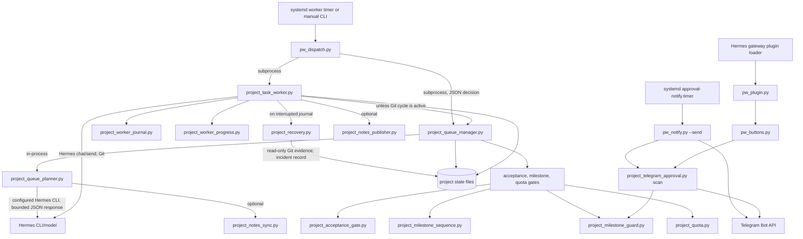

# Current architecture and execution flow

Audit baseline: commit `7fe441c9cf46ea3c67ce6cd03fa82eaa4f6124fd` on `main`. This describes the proof-of-concept as it exists; it does not propose or implement a refactor.

Evidence collected: an AST inventory of all 18 tracked `src/projectwright/*.py` files; the repository's installed-source manifest reports all 18 installed copies under `/home/leftyfb/.hermes/scripts/` match the source; read-only inspection of the installed Hermes plugin and user systemd units; and sanitized project/fixture state summaries. No source, fixture, unit, timer, or project configuration was changed. The repository has no `tests/` directory.

## Runtime flow

1. **Dispatch.** A manual invocation or a per-project systemd service runs `pw_dispatch.py --project ID`. The dispatcher dynamically loads the configured scripts, runs `project_queue_manager.py --once` through its injectable runner, and parses the JSON decision. It starts `project_task_worker.py --project ID --once` only when permitted. For an active Git cycle, a separate authorization gate checks the returned reason set, current queue order, prior task state, cycle metadata and repository snapshot before allowing the next TEST/COMMIT step. A held lock or blocked policy is not permission to run a worker. The sequence-test worker timer is disabled; no active Projectwright worker cron job was identified.
2. **Queue gate and planning.** The queue manager validates project identity/configuration, takes the project lock, reads queue, worker journal, recovery, Git, planning, acceptance and quota evidence, and emits a fail-closed decision. Strict milestone sequencing is evaluated before quota or planner/LLM work. A completed COMMIT milestone without a current acceptance receipt suppresses replanning. When planning is permitted, the manager calls `project_queue_planner.plan_once()` in-process.
3. **Planner.** The planner rechecks gates while holding the project lock, invokes the configured Hermes executable with a bounded timeout and JSON-only response contract, validates the proposal and concurrent queue state, then atomically appends tasks and updates planning state. Optional notes mirroring runs after releasing the project lock. The planner imports helper functions/constants from the queue manager, while the manager lazily imports the planner; this is a cross-module dependency cycle with one deferred edge.
4. **Task execution and Git cycle.** The worker supports one-task, dry-run, quota-check, journal-status, retry-authorization and detached modes. It acquires the project lock, reconciles journal state, and runs the configured Hermes agent with `chat --oneshot --query-file - --ignore-rules` through a timeout-controlled process. Structured results are validated against task kind; the worker itself does not establish semantic correctness. For an EDIT/TEST/COMMIT cycle, it snapshots Git state, isolates pre-existing changes with a stash when needed, enforces allowed-path/sequence rules, and requires the appropriate COMMIT task; ambiguous preparation or restoration failures require review rather than silent cleanup. The worker persists the queue checkbox and verified journal before incrementing progress. It then invokes `hermes send --to telegram --quiet` for its separate task-notification path; delivery failure can return a nonzero result even after task state was persisted.
5. **Recovery and re-entry.** An unresolved journal is inspected before selecting new work. Automatic reconciliation is limited to a verified non-COMMIT task with unchanged repository/HEAD, the original queue row now checked, and no active cycle. Otherwise the worker invokes `project_recovery.py --record`, which captures Git, queue-hash and journal evidence in a deduplicated incident record without changing Git, queue or worker journal. After processing, the worker invokes queue management again unless a Git cycle requires pausing; dispatcher output also includes a read-only progress summary.
6. **Human acceptance via Telegram.** The enabled Hermes `projectwright-approvals` plugin registers callback handlers. The notifier timer runs `pw_notify.py --send`; `pw_notify.py` scans projects, and `project_telegram_approval.py` creates a pending record only when a single eligible acceptance option is unambiguous. The notifier sends an HTTPS Telegram Bot API message with Approve/Reject callback data and suppresses duplicates. For callback authorization, the plugin accepts a comma-separated list of allowed decimal IDs from `TELEGRAM_ALLOWED_USERS` and requires a private chat, then offloads work with `asyncio.to_thread` to `pw_buttons.py`. Outbound approval messages impose a stricter configuration rule: the same environment variable must contain exactly one decimal ID; multiple IDs are accepted by the callback filter but cause notification send to refuse. Approval pins/revalidates current evidence and calls `project_milestone_guard.approve()`, which validates the requirement, milestone/task scope, Git history/HEAD and configured acceptance command before writing a receipt. Rejection writes a rejection record, creates no receipt, and does not replan. Stale or invalid requests are refused; the next eligible worker run may then plan past an approved acceptance gate. `project_telegram_approval.py` is the local state/evidence bridge and does not itself contact Telegram.
7. **Notifications.** Approval-request messages use direct HTTPS requests in `pw_notify.py`; they do not use the Hermes `send` CLI. Task notifications from the worker use `hermes send` as a separate integration. Credentials are sourced from local configuration/environment files and are intentionally not reproduced here.

## Dependency diagram

## Boundaries and standalone minimum

For equivalent queue/planning/task behavior without Telegram or notes, the execution core is `pw_dispatch.py`, `project_queue_manager.py`, `project_queue_planner.py`, `project_task_worker.py`, `project_milestone_guard.py`, `project_milestone_sequence.py`, `project_acceptance_gate.py`, `project_recovery.py`, `project_worker_journal.py`, and `project_worker_progress.py`. Keep `project_quota.py` if the configured quota gate remains part of the contract. A standalone application must replace the Hermes CLI/model boundary and systemd scheduling with explicit adapters or services; it should not treat the Hermes plugin, Telegram bridge, notes mirroring, or timer-install utility as core. This is a boundary finding, not a refactor plan.

## Runtime caveats

The installed copies are in manifest parity with source, but that proves content identity, not that every module is called. Runtime evidence shows the approval plugin is enabled and the approval-notification timer is active; the sequence-test worker timer is disabled. The `projectwright` config points at this repository but its configured `queue.md` is absent, so that project config is not currently runnable through the normal queue path. No claim is made that a worker is currently executing.
